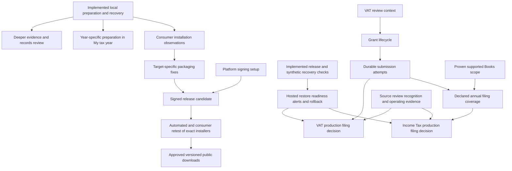

# TaxSorted roadmap and service map

Progress reviewed **30 September 2026**, against implementation through `4486638`.
This is the current product roadmap: audience needs, implemented modules, delivery
priorities and the evidence needed to finish them. Detailed contracts remain in the
linked accounting, infrastructure and testing documents. The rebuild began from
`origin/main` at `3e3fa56`; dated verification records below retain their original scope.

**Current position:** a useful local preparation service and recoverable desktop
preview are implemented. Automated native tests pass on Windows, Linux, Intel Mac
and Apple silicon. Consumer acceptance, trusted public installers and production
filing remain separate unfinished outcomes. This branch has not been released to
the public site. This review changes documentation, not tax rules or source dates.

## Purpose

Help a person understand what applies to them, organise the relevant records, and
take the next useful step towards sorting their tax. Begin with individuals, UK
sole traders and UK landlords. Give advisers and organisations useful, accurately
bounded routes into the same tools.

The interface should answer: Is this for me? What can I do now? Where will my work
be kept? What happens next?

## Progress at a glance

**Implemented** means code and recorded checks exist within the stated scope.
**Partial** means a useful path exists with named missing capability.
**Pending** means the required observation, decision or implementation is absent
from this review. Test results do not imply publication or external approval.

| Area | Current progress | Remaining boundary and evidence |
|---|---|---|
| Service entry and navigation | Implemented: shared catalogue, search, audience pages, contextual Books links and six navigation locales | Individuals, sole traders and landlords lead. Audience choice is not a tax-status determination. The secondary `/tools` page still needs copy alignment. [Catalogue](../frontend/src/lib/tax-services.ts) |
| My tax year | Implemented: explicit saved-progress read, up to three next actions and separately saved manual checklist | Books counts cover 2026–27; Passport/checkmarks are general. Preparation drafts are not yet included. [Progress reader](../frontend/src/lib/tax-year-progress.ts) |
| Individual preparation | Partial: separate 2025–26/2026–27 drafts, circumstances, evidence tasks, P60 review, selective summary and stale-save protection | P45 and other employment sources stay unresolved; other income types have evidence tasks. No complete annual calculation, filing-obligation decision or submission. [Preparation contract](../frontend/src/lib/return-preparation.ts) |
| Tax summary and adviser handover | Implemented: explicit local Passport save, versioned JSON and print; separate year-specific preparation summary | No shared adviser workspace, document inspection or client authority. Exported handovers are unencrypted. [Passport contract](TAX-POSITION-PASSPORT.md) |
| Money records and accounting | Partial: manual/CSV intake, review/history, supported trade/property separation and cumulative Income Tax quarter figures | Cash records and tax-category postings, without bank reconciliation, full double-entry accounts or Books-to-VAT derivation. [Accounting scope](ACCOUNTING-PRODUCT.md) |
| Workspace recovery and privacy | Implemented and native-tested: encrypted saved-workspace export, protected safety copy, atomic restore and stale-editor protection | Covers saved Books, Passport, both preparation years and checklist. Live profiles remain unencrypted by the app; unsaved forms, original documents, attachments and account credentials are excluded. [Storage contract](LOCAL-APP.md#where-personal-data-lives) |
| Installers and scaffolding | Automated native checks pass on all four targets; personal source scaffold and acceptance packs are prepared | Consumer M01–M15 remain NOT RUN. Mac previews are ad-hoc and rejected by Gatekeeper; Windows is unsigned; stock Ubuntu remains unproven. Public downloads are not published. [Desktop evidence](DESKTOP-TESTING.md) |
| Infrastructure foundations | Implemented locally: reproducible full install, shared 35-route release contract and synthetic PostgreSQL 16/17 recovery | Database CI is prepared but not run; real hosted recovery, readiness/alerts and rollback remain unverified or planned. [INF-01–06](../infrastructure/README.md#infrastructure-roadmap) |
| Financial providers and HMRC | Partial: account/passkey controls, closed Xero authorisation foundation and separate HMRC sandbox journeys | No real financial-provider reader, complete annual filing or established production scope. Grant lifecycle, durable attempts and external evidence remain work. [Production gaps](PRODUCTION-GAPS.md) |

Recorded verification includes all **12** source/packaged/installed native recovery
runs at `af4a5ab`, all four installer lifecycle checks, **79** desktop tests after
acceptance tooling, and three actual Mac native-dialog checks in an isolated source
profile. Earlier frontend, engine, API, scaffold and database results retain their
own revisions and scopes in the [testing plan](DESKTOP-TESTING.md) and
[infrastructure record](../infrastructure/README.md#first-implementation-batch).
The latest rebuild export contains 83 generated pages; that inventory is not a count
of fully supported tax services. This documentation review does not rerun those tests.

## How the service closes the knowledge gap

| What a person needs | What helps today | Next useful improvement |
|---|---|---|
| Know where to begin | Situation-based services, circumstances questions, explanations and bounded checks | Keep secondary navigation and capability descriptions consistent with the main service paths |
| Know what to collect | Named evidence tasks, unknown/missing states and guided P60 entry | Extend one document/source journey at a time, with reviewed sources and overlap checks |
| Know what remains to do | Saved Books/Passport overview, manual reminders and preparation review | Bring the selected year's saved preparation into My tax year without implying filing readiness |
| Keep control of sensitive work | Offline desktop, explicit local saves, encrypted workspace transfer and selective handover | Complete consumer recovery/installation checks and explain profile protection alongside export protection |
| Get help or finish filing | General Passport, year-specific summary, adviser path and official filing routes | Make the two handovers easier to distinguish; admit actual filing only within a proven scope |

The intended journey is **choose a situation → choose a year and purpose → gather
evidence → review records and unresolved questions → prepare a handover or use an
available filing route → keep a recoverable copy**. Today the missing connection is
the selected preparation draft's progress in the overview. A completed checklist,
reviewed P60 or exported handover does not mean a complete return has been filed.

## Service map

| Entry | Job | Existing capability reused |
|---|---|---|
| `/` | Choose a starting point or resume records | Audience catalogue, MTD check, records workspace |
| `/services` | Find a service by situation or task | Searchable catalogue; no new tax logic |
| `/services/individuals` | Prepare personal evidence and understand income | Year-specific preparation, personal-tax checks, Income Tax guide, Passport, official help |
| `/services/sole-traders` | Work from an MTD check through records to preparation | MTD, local books, sole-trade projection, quarter totals |
| `/services/landlords` | Keep property work distinct from a sole trade | MTD, property records, landlord guidance, quarter totals |
| `/services/advisers` | Help someone prepare an inspectable handover | Expert coverage, deeper MTD check, Passport export |
| `/services/organisations` | Understand scope before entering data | Tax-identity map, labelled VAT test workspace, guidance |
| `/checkup?for=landlords` | Resume saved work in My tax year and keep personal reminders | Optional local Books/Passport progress; catalogue destinations and explicit checkmarks |
| `/books` | Choose and open money records | Existing browser-local Books workspace |
| `/books/connect` | Bring in existing records | Manual entry and CSV; truthful provider availability |
| `/file` | Prepare and find an actual filing route | Existing quarter/VAT preparation and official authority routes |
| `/passport` | Prepare a tax summary and handover | Existing Passport contract, save, export and print |
| `/prepare` | Prepare evidence for a particular tax year | Separate local drafts, circumstances, evidence checklist, P60 capture and summary preview |
| `/backups` | Keep or recover the saved workspace | Encrypted complete-workspace export and atomic restore; explicit safety copy and replacement |
| `/download` | Choose local installation or personal scaffolding | Platform scope, source setup and data-custody explanation; public installer links pending |

Audience choice is navigation context, not a determination of tax status. People
may use several paths. A landlord is never routed into the sole-trader-only
trading-allowance comparison.

## Names and navigation

Keep TaxSorted as the product name and preserve established URLs, data formats
and storage keys. Rename visible tasks to explain what the person can do.

| Previous public name | New entry name | Stable destination |
|---|---|---|
| Check / Tax Checkup | My tax year | `/checkup` |
| Books / Starter Books | Money records | `/books` and `/books/workspace` |
| File and pay | Prepare a return | `/file` |
| Tax Position Passport | Tax summary and handover | `/passport` |
| Understand | Tax guides | `/learn` |
| Put it right | Help & corrections | `/put-it-right` |
| Plan | Compare sole-trader choices, where supported | `/plan` |

Global navigation: Services, My tax year, Money records, Tax guides, and Help &
corrections, with Account and language controls as utilities. The old capability
families remain available through their existing routes.

## One mechanism per concern

- `frontend/src/lib/tax-services.ts` owns audience order, service destinations,
  actions and capability descriptions. Homepage, directory, audience pages and
  checklist consume it. Ordered checklist tasks and additional relevant services
  are separate, so a short checklist does not hide CSV import from search. The
  catalogue does not own tax rates or eligibility.
- `engine/` still owns calculations, effective dates and source-review stops.
  This rebuild does not change them or renew their evidence dates.
- My tax year reads local Books and Passport progress only after **Show my saved
  progress**. It displays a temporary snapshot and up to three next actions for
  individuals, sole traders or landlords. The reader uses the existing stored
  values without creating or migrating records. Refresh is explicit; hiding the
  snapshot, changing audience or leaving the page clears it. No snapshot or
  permission preference is saved, and no tax figures are displayed or uploaded.
- Books counts cover **6 April 2026–5 April 2027** and keep trading/property
  activities separate. Passport progress is general, not tied to that tax year.
  Missing, older, damaged and inaccessible records remain distinct from an empty
  review queue. The view does not establish completeness, eligibility, tax due,
  reviewed evidence or filing readiness.
- The personal checklist retains its established storage key and format. It
  saves only the selected audience and manually checked service steps after an
  explicit save. These reminders are not year-specific and never change when a
  snapshot is read or a tool is opened. No account is required.
- `frontend/src/lib/books-navigation.ts` carries only a recognised activity
  through workspace links. Existing `start=csv|manual` and fragment targets
  survive. No identifiers or arbitrary incoming query parameters are copied.
- `frontend/src/lib/accounting-integrations.ts` remains the provider-status and
  official-link registry. Authorisation, import and filing stay separate.
- The static Next.js export remains the delivery model. No second backend,
  duplicated account system, cloud ledger or paid service is introduced.
- `frontend/src/lib/workspace-storage.ts` coordinates saved domains through a
  canonical IndexedDB workspace after deliberate activation. Existing storage keys
  and older Books formats retain compatibility; restore has one generation boundary.
  The browser and desktop still have distinct profiles and transfer files explicitly.

The configured hosting path is **Cloudflare Pages → browser**, with online actions
using **browser → Hono API on Fly.io (Node 22) → PostgreSQL**. The offline **Electron** app bundles
the same frontend and TypeScript engine and needs no hosted backend to run.
Supabase and Railway are not dependencies; the former AWS plan was retired.
Keep the [infrastructure and data map](../infrastructure/README.md) authoritative
for stack, custody and integration details.

## Integration boundaries

| Capability | What it does today | What it does not do |
|---|---|---|
| Money records | Manual/CSV intake, review, separate supported trade/property books, totals and backup | Bank-feed reconciliation, general company accounts, automatic cloud backup |
| Activity context | Keeps a property entry selected through workspace/import links | Treats audience choice as confirmed ownership or a tax fact |
| Passport | Deliberate local save, export and printable handover | Shared adviser workspace, inspected documents, client authority |
| Return preparation | Year-specific drafts, evidence states, checked P60 figures and a selective summary | Complete annual return, obligation decision, automatic Passport/Books import, tax calculation or HMRC submission |
| Accounting providers | Describes import routes; Xero has a closed authorisation pilot in the backend | Public provider imports or a working Xero financial reader |
| HMRC | Existing, explicitly authorised VAT/Income Tax sandbox journeys | Production filing, complete Income Tax year-end filing or recognition |
| Accounts | Existing sign-in/session capabilities | Backup of local records or an adviser/client relationship |

## Implementation and acceptance

1. **Establish the baseline.** The older `taxsorted.io` checkout is a VAT
   prototype. Build from current main in an isolated worktree and preserve the
   existing checkouts and branches.
2. **Make the front door useful.** A visitor reaches a relevant tool from an
   audience page or searches by task. Each service names its scope and links to
   an implemented route.
3. **Connect the journey.** The checklist remembers explicitly saved progress,
   keeps audience progress separate and handles inaccessible/malformed browser
   storage. Opening a tool never means the tax work is complete.
4. **Repair context loss.** Property context survives Today/Money/Business/Tax
   navigation and import actions. It suggests an activity for entry; existing
   records are not rewritten or reclassified.
5. **Simplify work pages.** Records, importing, preparation and handover lead
   with actions. Detailed accounting/delivery-state explanations sit in
   disclosures rather than preceding the task.
6. **Verify.** Component/persistence tests, frontend/engine suites, TypeScript,
   lint, gated static build, route/anchor checks and desktop/mobile journeys.
   Use synthetic inputs only.

## Next delivery work

Local preparation can improve while target devices and hosted operating evidence
are arranged. The table orders outcomes within their scope; online work is not a
prerequisite for offline preparation. Owner labels describe roles, not assigned people.

| Priority and state | Outcome | Completion evidence and dependencies | Responsible role |
|---|---|---|---|
| Now · environment needed | Exercise consumer installation and recovery | Use the [exact-candidate packs](DESKTOP-TESTING.md#consumer-acceptance-preparation--30-september-2026) on Windows 11 x64, stock Ubuntu x64 GNOME, Intel Mac and the Apple silicon control in disposable accounts. Record M01 trust/prerequisite blocks and run reachable cases; feed findings into the release candidate. Do not bypass security to complete the current preview. | Release maintainer and native-device testers |
| Next code · ready to start | Join preparation into My tax year | Explicit year choice, read-only saved-draft status and a useful resume action; preserve opt-in reads, year separation, unknown states and existing Books-period limits. See the bounded slice below. | Frontend and local-storage maintainer |
| Next code · ready to start | Align trust and task copy | Update secondary `/tools` labels and its unsupported Books-to-VAT wording; update `/download` to distinguish automated testing from consumer acceptance. Distinguish general Passport from year-specific handover. Validate affected links/copy and keyboard paths. | Product/frontend maintainer |
| Dated · due 12 October 2026 | Renew MTD source evidence | Assign an accountable reviewer; inspect the primary sources and record outcomes before the 13 October overdue stop. Preserve the stop if review is incomplete. This is a source review, not a date-only edit. [PG-02](PRODUCTION-GAPS.md#pg-02--renew-mtd-source-evidence-without-weakening-the-stop) | Engine/source reviewer; person unassigned |
| Parallel · implementation and operations | Prove hosted continuity | Run the prepared synthetic database CI; implement readiness/redacted diagnostics and alert checks; inventory real backup/key dependencies and define recovery objectives before an authorised isolated hosted restore and API/frontend rollback exercise. [INF-03–05](../infrastructure/README.md#infrastructure-roadmap) | Infrastructure and service operator |
| Pending · alongside consumer findings | Publish trustworthy desktop releases | Configure Mac Developer ID/notarisation and Windows signing; fix target-specific packaging. Retest the resulting bytes with native automation and M01–M13/M15, resolving P0/P1 issues. M14 needs two versions. Retain checksums/versioned download links and record the exact publication decision. | Release maintainer and publisher |
| Independent release · pending | Publish the website rebuild | Run the existing release contract and API/frontend checks for the selected revision, review visible capability claims and record publication/rollback decisions. Desktop signing and consumer acceptance do not gate this separate delivery. | Web release maintainer and publisher |
| Then · scoped product work | Deepen evidence and money-record review | Add one supported document/source journey, starting with employment changes/P45 subject to source review; clarify handover choices. In Books, finish changed-imported-row decisions before widening imports, then prove scope/reconciliation under [PG-04](PRODUCTION-GAPS.md#pg-04--prove-business-scope-and-completeness). | Preparation/engine and accounting maintainers |
| Separate online track · planned | Reliable integrations and supported filing | PG-05 VAT review context → PG-07 grant lifecycle → PG-08 durable attempts → PG-09 declared annual filing scope. A read-only provider pilot follows its own PG-04/PG-11/PG-12 gates; it is not required for a manual/CSV filing path. Books-to-VAT is PG-10. [Detailed dependencies](PRODUCTION-GAPS.md#concrete-batches-and-parallel-sequence) | API/accounting maintainers and operating-evidence owners |
| Later · unadmitted | Shared adviser service and wider coverage | Client authority, tenant isolation, explicit sharing/revocation and support/privacy evidence before shared client data. Additional providers, company accounts and jurisdictions require their own supported scope. | Product, security and service owners |

### Next development slice

Connect `/checkup` to saved preparation without introducing another store or tax
calculation. This is the recommended next implementation, still **planned**:

1. Let the person choose 2025–26 or 2026–27 deliberately and resume that exact saved
   preparation year. Keep Passport/checkmarks labelled general and Books labelled
   2026–27 until a separate year-aware Books contract is implemented.
2. Extend the existing opt-in progress read with counts/status from the saved draft.
   Show unanswered, unknown, unreviewed and unsupported work distinctly. Opening
   the page, hiding the snapshot or changing year must not copy, save or relabel facts.
3. Offer at most three relevant next actions through the existing catalogue/domain
   helpers. State what the year-specific summary covers and how it differs from a
   Passport; do not infer tax due, an obligation to file or return completeness.
4. Verify no reads before consent, no record writes, both years, missing/damaged
   storage, stale asynchronous reads after a year change, exact resume navigation,
   keyboard/focus and narrow layouts. Recheck desktop staging and source scaffolding
   because both editions share the same frontend.

### Release dependencies

Public desktop distribution and production tax filing have separate release
decisions. Encrypted exports protect transferred files; full-profile encryption,
automatic updates and cloud sync are not delivered capabilities. Keep browser and
desktop records separate unless the person deliberately transfers a backup.

## Verification record — 29 September 2026

Verified with Node 22.23.3 against this local worktree:

| Check | Result |
|---|---|
| `npm test --workspace frontend` | 106 files, 737 tests passed |
| `npm test --workspace @taxsorted/engine` | 31 files, 388 tests passed |
| `npm run typecheck --workspace frontend` | Passed |
| `npm run lint --workspace frontend` | Passed |
| `npm run build` | Static export passed, including prebuild review check and postbuild publication guard |
| Exported routes/anchors | 374 internal links across 12 entry pages resolved |
| Chromium desktop/mobile | 12 pages at 1440px and 375px; no horizontal overflow or page errors |
| Translated navigation | All six locales at 320, 375, 768, 1280 and 1440px; no horizontal overflow |
| Interactive journeys | Explicit checklist save/reload, separate audience progress, property context through four Books sections, property-entry default, search/empty recovery, mobile Escape/focus passed |
| `git diff --check` | Passed |

Browser verification used an isolated profile, synthetic choices, and blocked
all non-local HTTP requests. It did not connect a live provider, create an
account, or submit tax data. Screenshots and the browser report are in
`/tmp/taxsorted-service-preview/`; the local static preview is on loopback port 4318.

The full-workspace dependency install hit an existing HTTP 404 for the API's
`@agenttool/sdk` release tarball. A scoped frontend/engine lockfile install
succeeded without dependency changes. The API suite was not run; backend code,
credentials and deployment configuration were not changed. No push or deployment
was performed. The public site still serves the previously deployed version.

**Infrastructure follow-up — 30 September:** the exact SDK version is now available
from npm with the same lockfile integrity. Full-workspace installation succeeds after
changing that download source. The [infrastructure roadmap](../infrastructure/README.md#infrastructure-roadmap)
records the new combined verification separately from this earlier frontend-only campaign.

## My tax year — 30 September 2026

This records the first delivery. The later workspace recovery implementation routes
the same logical data through `createWorkspaceSession()`; the four-key transaction
description and read counts below apply to this earlier walkthrough.

`/checkup` now joins optional saved-work progress to the existing personal
checklist. The primary audience pages, homepage, six navigation translations,
footer and desktop menu use **My tax year**. Adviser and organisation journeys
retain their personal checklist without reading records for a client.

`frontend/src/lib/tax-year-progress.ts` reads four existing IndexedDB keys in one
read-only transaction after the visitor's request. It validates Books before
counting events in the fixed 2026–27 period. Excluded-only business groups do not
prompt confirmation. Older formats or unseen legacy records prompt opening Books
for its existing migration path; the overview never migrates them. Passport
evidence uses the same effective-state helper as the Passport page, so sources
marked absent do not produce irrelevant evidence tasks. Only counts, status and
timestamps reach the panel. Opening IndexedDB may initialise an empty database
on a fresh profile; the overview writes no saved tax records or consent preference.

The panel puts up to three next actions before detailed counts. It distinguishes
when the snapshot was read from when the Passport was saved, requires an explicit
refresh for later changes, and discards pending results after hide, unmount or
audience change. Existing checklist storage is unchanged. Books action links keep
activity context, but their destinations still show all saved dates/businesses.

Verified locally with Node 22:

| Check | Result |
|---|---|
| Frontend suite | 933 tests across 112 files passed, including 47 reader and 20 panel cases; 36 affected page/panel tests rerun after final layout changes |
| Desktop boundary suite | 51 tests passed |
| Source scaffold | Nine tests passed; fresh copy includes the new module/tests and Backups route, excludes generated browser evidence |
| Frontend TypeScript and ESLint | Passed |
| Static export and offline staging | 81 pages; research publication gate remained closed |
| Source Electron walkthrough | Seven existing runtime checks passed; synthetic checklist, navigation, encrypted recovery and cleanup preserved |
| Isolated browser walkthrough | Opt-in only, four IndexedDB reads and zero record writes; period/activity separation, unknown versus unanswered, maximum three actions, hide/focus, audience change and checklist persistence checked |
| Layout | 320px, 390px and 200% zoom without horizontal overflow; wide and narrow views reviewed |

Browser checks used synthetic records in a fresh context, with zero renderer errors
and zero external request attempts; the context was closed afterwards. The retained
sanitised report and screenshots are under `desktop/test-results/my-tax-year-*`.
The source Electron report is supplementary local evidence, not a new native
installer campaign. Existing downloaded installers retain their earlier recorded
revision. No tax calculations, accounts, provider connections or HMRC submissions
were added, and no production deployment was performed.

## 30 September 2026: individual return preparation

`/prepare` connects circumstances to evidence and a preparation review. Each
supported year, 2025–26 or 2026–27, has a separate local draft. The purpose is
explicit: prepare an annual return or organise that year's records. Current-year
P60 entries cannot be marked reviewed while the year is still running.

Opening the page does not read personal drafts. Starting or resuming deliberately
reads the chosen year; saving is a separate action. Atomic revision checks reject
stale saves, and malformed stored drafts are preserved. No Passport, Books or
personal-checklist facts are imported or reassigned to a year.
Unsaved edits survive client navigation in a temporary, same-tab recovery slot.
Returning offers explicit recovery; pending saves are awaited before recovered
edits are enabled, so a committed revision is not mistaken for a stale draft.
Reload or quit ends that memory-only recovery. The desktop's native unload prompt
defaults to keeping edits; it never silently saves or grants online access.

The first guided evidence task is a P60 employment entry. A review requires a
matching document year, an employer and source label, explicit pay and tax figures,
and the person's confirmation. Blank amounts remain unknown; negative tax records
a refund. Material edits remove the review mark. P45 and other sources remain
unresolved; repeat employers or document labels prompt an overlap check. There is
no annual aggregation, tax calculation, filing-obligation decision or submission.

Other circumstances generate evidence tasks with user-recorded statuses. A status
does not mean TaxSorted has inspected a document. Previously entered employment
sources remain stored when the person changes their circumstances, and are labelled
inactive in the summary. Underlying documents stay with the person.

The summary preview lets the person choose whether to include figures and notes.
The downloaded text is unencrypted and is not a restorable backup. The later
encrypted workspace flow at `/backups` includes saved preparation drafts for both
supported years; Books-only backups still exclude them. The live draft uses ordinary browser/app storage;
this feature adds no cloud service, document upload or account requirement.

Field guidance was checked against [HMRC employment notes](https://www.gov.uk/government/publications/self-assessment-employment-sa102),
[P60 guidance](https://www.gov.uk/paye-forms-p45-p60-p11d/p60) and
[record guidance](https://www.gov.uk/keeping-your-pay-tax-records/overview).

Verified locally with Node 22:

| Check | Result |
|---|---|
| Frontend suite | 1,032 tests across 115 files passed, including 75 preparation domain/store and 23 guided UI tests |
| Desktop and scaffold suites | 51 desktop tests and nine scaffold tests passed |
| TypeScript and ESLint | Passed |
| Static build and desktop staging | 82 pages, including `/prepare`; publication gate remained closed |
| Fresh scaffold | 888 source files; preparation source/tests and Books Backups route included, generated browser evidence excluded |
| Isolated Chrome walkthrough | Nine checks passed: explicit I/O, blank/zero/refund handling, year matching, review invalidation, selective export, reload, stale-save refusal and same-tab Back/Forward recovery |
| Layout | Evidence forms fit 320px, 390px and 200% zoom; desktop and mobile screenshots inspected |
| Source Electron walkthrough | Seven runtime checks passed, extended with native leave cancellation/approval and preparation persistence across full quit/relaunch |

The browser walkthrough recorded zero renderer errors and zero external request
attempts. The Electron walkthrough recorded zero renderer errors and zero observer
requests; its app and observer closed and its temporary files were removed.
Reports and synthetic screenshots are under `desktop/test-results/preparation-*`
and `desktop/test-results/source-smoke.json`. This is source runtime evidence on
this Mac, not a new Windows/Linux/Intel Mac installer result.
Existing downloaded installers remain at their recorded earlier revisions.

**Later native verification:** the [complete workspace campaign](DESKTOP-TESTING.md#complete-workspace-recovery-campaign--30-september-2026)
at `af4a5ab` includes preparation and recovery on Windows, Linux, Intel Mac and Apple
silicon. Acceptance packs at `4486638` contain that candidate. The earlier paragraph
describes the preparation-only checkpoint, not the latest installer status.
