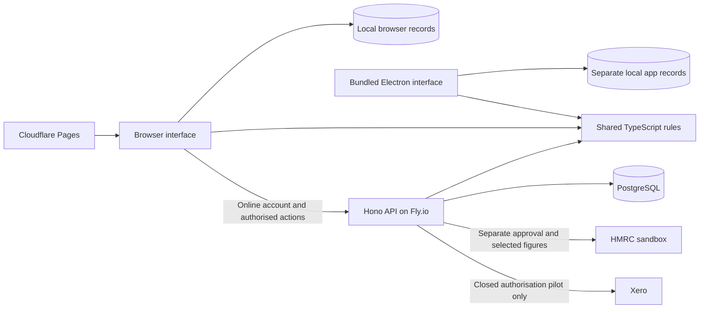

# Infrastructure and data map

Repository map reviewed **2026-09-30**, against service-rebuild code at `6175c20`.
This is the entry point for the current stack, data custody and integration boundaries.
The rebuild branch includes features that have not been deployed to `taxsorted.io`.
Configuration and local tests do not establish live provider access or production filing.

## Stack and purpose

| Layer | Implementation | Purpose and boundary |
|---|---|---|
| Website | Next.js 16 static export, React 19, TypeScript, Tailwind 4; Cloudflare Pages | Serves the interface and bundled guidance. Local tools run in the browser; there is no Next.js server runtime in this deployment. |
| Local desktop | Electron, the same static frontend and tax engine; Windows, Linux, Intel and Apple silicon macOS packaging | Runs bundled preparation tools without a TaxSorted account or backend. Remote app requests, account sign-in, provider sync and online filing are unavailable. |
| Shared rules | `engine/`, TypeScript | Supported calculations, tax contracts, validation and accounting-sync contracts. Its older HMRC subtree still includes browser/network helpers; complete transport separation remains work. |
| Local records | IndexedDB and localStorage | Books, Passport, preparation drafts and checklists have separate stores. The browser and desktop have separate profiles; account sign-in does not synchronise or back them up. |
| Online API | Node 22, Hono, Zod/OpenAPI; Docker on Fly.io, primary region `lhr` | Account and entity access, provider grants, HMRC sandbox routes and scoped developer APIs. London is the configured API region, not proof of UK-only processing by every service. |
| Hosted database | PostgreSQL, `postgres.js`, SQL migrations | Accounts, sessions, tax entities, grants, sync-control state and submission payloads/receipts. It is not a cloud copy of local Books or preparation drafts. |
| Authentication | WebAuthn passkeys and recovery codes; separate scoped workspace API keys | Recovery-only sessions cannot access protected tax data until upgraded with a passkey. Provider OAuth grants and HMRC authorisation are separate from TaxSorted sign-in. |
| Delivery | GitHub Actions, Fly.io API release, Cloudflare Pages frontend release; Electron Builder for desktop | Web release checks run before publication. Native desktop build/test workflows are separate from website deployment. |

There is **no Supabase or Railway dependency** in this implementation. The former AWS
Aurora/VPC plan was retired. Vercel is a preview/manual fallback. Keep Cloudflare + Fly +
PostgreSQL as the current hosted path; adding another provider is not needed for local
preparation or the existing API. A future hosting replacement should have a concrete
operational reason and an explicit migration, rather than duplicate this stack.

The desktop runtime needs none of those hosted services. Building or scaffolding from
source needs Node 22 and downloaded dependencies; see [local setup](../docs/LOCAL-APP.md).
A local API additionally needs PostgreSQL, `DATABASE_URL` and `TOKEN_KEY`; startup applies
migrations. HMRC and Xero credentials are separate optional integration configuration,
not prerequisites for offline preparation. See [API setup](../api/RUNBOOK.md).

## Where information moves



| Information | Current home and protection |
|---|---|
| Books events, review history, imported records | Local IndexedDB. The app does not encrypt the live profile. Books backup files are password-protected by default and can be restored deliberately. |
| Passport facts, tax-return preparation drafts, personal checklist | Separate local persistence; excluded from Books backups. Passport and preparation exports have their own scope and are unencrypted. There is no complete encrypted workspace backup. |
| Underlying P60s and other preparation documents | Remain with the person. The preparation journey records checklist state and entered figures; it does not upload evidence documents. |
| Accounts, sessions and tax entity identifiers | Hosted PostgreSQL when online account features are used. Entity fields can include NINO and VAT registration number; local-first is not a claim that the API holds no sensitive data. |
| Provider/HMRC access and refresh tokens | API-side encrypted token custody. Tokens are not delivered to the browser; token encryption does not encrypt every database field. |
| Approved HMRC submission | Selected payload and authority receipt are held by the API. A deliberate online submission sends those figures outside the local store. |
| Accounting sync control | API holds selected organisation bindings, leases, manifests and checkpoints. The working synthetic proof keeps financial records in a separate local replica. Real provider financial import is not implemented. |

## Accounting and integrations: implemented scope

The current accounting path is **manual entry or CSV → review → confirmed business →
supported cumulative Income Tax quarter totals → separate sandbox approval → receipt**.
Unreviewed, excluded or unconfirmed records do not enter those quarter totals. Preparation
P60 figures remain in their separate year-specific draft; they do not feed a complete annual
return automatically.

Books uses cash events with income/expense tax-category postings and preserved review
history. It is not yet a balanced double-entry ledger: no chart of accounts, trial balance,
derived balance sheet, bank reconciliation or statutory accounts. Recorded totals do not
prove completeness or tax due. Books-to-VAT derivation, complete year-end filing and
production HMRC filing also remain gaps. See [accounting scope](../docs/ACCOUNTING-PRODUCT.md)
and [production work](../docs/PRODUCTION-GAPS.md).

| Integration | What exists | What remains |
|---|---|---|
| CSV/manual | Local import/entry and human review in Books | Provider connectivity and automatic reconciliation |
| Synthetic provider | Development-only fictional pages, local atomic commits, exact acknowledgements and completed-run checkpoints; requires a local API, database and full passkey session | Real financial-provider evidence; the demo is disabled in production and does not populate ordinary Books |
| Xero | Default-closed pilot for OAuth, encrypted grants, organisation selection and entity binding | Financial record reader/import and public customer admission; connecting does not import transactions |
| QuickBooks, FreeAgent, Sage | Guides/catalogue entries | Callable financial adapters |
| HMRC VAT/Income Tax | Separate sandbox connections, supported obligations/submission routes and receipts | Production recognition, complete annual-return coverage and durable handling of uncertain submission outcomes |

The connector contract checks a page's identity and digest, commits its records locally,
then acknowledges that exact page. Only a completed, acknowledged run advances the whole
checkpoint; expired sync ownership cannot continue writing through a newer run. These are
the implemented synthetic protocol boundaries, not proof of any live provider's data.
The [integration design](../docs/ACCOUNTING-INTEGRATIONS.md) also describes future
reconciliation, attachments and readiness gates; its target diagrams are not current
capability lists. Provider consent, record review and filing approval remain separate actions.

## Verification and remaining infrastructure work

On **2026-09-30 at 12:37 UTC**, unauthenticated GETs returned HTTP 200 for the homepage
(response server `cloudflare`) and `/v1/health` (response server `Fly`). Health reported
`ok=true`, HMRC configured, environment `sandbox`. The [health handler](../api/src/app.ts)
reports process/configuration state; it does not query PostgreSQL or call HMRC. These
observations do not verify database recovery, provider credentials, recognition or a deployed
match to this branch. No private provider account or database was inspected in this review.

The [infrastructure roadmap below](#infrastructure-roadmap) sequences the release,
installation and database-recovery gaps found in this review. Native installer checks
do not exercise the website release path; local Books restore tests do not establish
hosted database disaster recovery.

The [release scripts](../scripts/release/README.md) define smoke contracts; the workflow
owns their order and publication-state handoff. The [September 12 audit](../docs/ARCHITECTURE-AUDIT.md)
is historical evidence. [Service ownership](../docs/SERVICE-REBUILD.md), [local packaging
and privacy](../docs/LOCAL-APP.md), and [Books backup coverage](../docs/BOOKS-BACKUP.md)
hold the detailed contracts rather than duplicating them here.

## Configured hosting and earlier operator observations

- **Frontend** — Next.js static export on **Cloudflare Pages** (project `taxsorted`).
  A push to `main` deploys it only after the API release and its live checks succeed.
- **API** — Hono on **Fly.io** in London with Postgres. The release workflow deploys the
  API first and checks its public contracts plus authenticated, stateless SDLT and tax-expert
  answers before the frontend can move.
- **CI** — `.github/workflows/deploy.yml` runs tests, typechecks, data validators, a
  high-severity production dependency audit and the static build on every push to `main`.
  It deploys the Fly API first, then Cloudflare Pages only after Fly succeeds. Both deployment
  tokens are required. (Its first three runs, 2026-06-06, ended in `startup_failure` — a
  GitHub-side validation hiccup; re-verified green by manual dispatch 2026-06-12.)
- **Domain** — Cloudflare. `taxsorted.io` is canonical; earlier operator notes record
  a Dynamic Redirect sending `www` to the apex with path and query preserved. DNSSEC
  was enabled on 2026-07-12; its current status was not checked in this review.
- **Vercel** — preview/manual fallback only. Project `taxsorted-io` stays linked to
  this repository, but `frontend/vercel.json` disables automatic `main` deployments
  and the production custom-domain aliases have been removed. Production must have
  one release path, not two.
- **Runtime** — Node 22 in CI and the Fly image. Root and frontend `engines` plus
  `.nvmrc` keep local and Vercel preview builds on the same major.

The Fly service-level readiness check calls `/v1/health` every 30 seconds. The
release smoke test also asserts that HMRC is configured for the sandbox; a 200 with
the wrong rail state is not considered healthy.

## Operator quick check

The canonical repository is `cambridgetcg/taxsorted.io`. The older
`cambridgetcg/taxsorted` repository and Vercel project are legacy and do not serve
the production domain.

```bash
gh auth status
vercel whoami
fly auth whoami

gh run list --repo cambridgetcg/taxsorted.io --limit 5
vercel project inspect taxsorted-io --scope cambridgetcgs-projects
fly status -a taxsorted-api
fly checks list -a taxsorted-api
fly status -a taxsorted-db
```

The local checkout can be linked without committing credentials or project IDs:

```bash
vercel link --yes --scope cambridgetcgs-projects --project taxsorted-io
```

`.vercel/` is ignored. Fly linkage is the tracked `api/fly.toml`; GitHub linkage is
the `origin` remote.

Earlier operator notes describe one Postgres machine and one encrypted 1 GB volume
with Fly snapshots, without high availability. Current machine health, capacity,
snapshot retention and restore success were not reverified on 2026-09-30. Do not
blindly redeploy its internal staged secrets merely to clear their CLI status;
verify runtime behavior and take a snapshot before any database-machine change.

The canonical-host redirect lives in Cloudflare Dynamic Redirect ruleset
`3a88600352ff464d9c23da1a4ecb080f` (rule
`bbd9c61626624d659d5caaed3208eaf0`). DNSSEC uses key tag `2371`, algorithm `13`,
and digest type `2`. These identifiers are operational metadata, not secrets.

The authenticated release canaries use one test-mode workspace key with the
`tax-expert:assess` and `sdlt:calculate` scopes. They first inspect that presented key without tax
facts, then run both professional tasks. Its plaintext exists only as the GitHub Actions secret
`TAX_EXPERT_CANARY_API_KEY`; Postgres stores its digest. The secret and database workspace names
predate the SDLT canary. It expires on 12 July 2027. Use the operator lifecycle command to mint and
verify an overlapping replacement before updating the GitHub secret, then explicitly revoke the
old key. The emergency off-switch is an explicit last-key revocation plus deletion of the GitHub
secret; do not remove any success-path check merely to avoid rotation.

### Workspace-key operations

Run these only from a private terminal connected to the intended database. Check public health
first, then use a dedicated temporary [Fly console](https://fly.io/docs/reference/configuration/#the-console_command-option)
with extra memory. It uses the current release image and secrets, receives no public traffic, and
is destroyed when the console exits:

```bash
curl --fail --silent --show-error --max-time 20 https://api.taxsorted.io/v1/health
fly console --app taxsorted-api --region lhr \
  --vm-cpu-kind shared --vm-cpus 1 --vm-memory 512 \
  --user node --command /bin/sh
```

Do not use `fly ssh console` or `fly machine exec` on a serving API machine for key work. On 15 July
2026, a harmless `--help` check loaded unrelated server configuration and remained across
autosuspend; while it remained, the 256 MB serving machine returned brief `502` responses. It
changed no database data. The eager load is fixed, but process isolation remains the safer
boundary. In the temporary console, disable shell tracing and start with the built-in contract:

```bash
set +x
npm run manage:api-key --workspace api -- --help
EXPIRES_AT="$(node -e 'console.log(new Date(Date.now() + 365 * 864e5).toISOString())')"
```

Open a fresh temporary console for each `create:api-key`, `issue`, `rotate` or `revoke` mutation.
Move any plaintext immediately into the approved private store, retain only non-secret metadata,
and exit. Do not create a transcript or screenshot. Do not put a generic timeout around creation,
`issue` or `rotate`: the database commit can succeed before the plaintext is printed. If the
connection ends before the result is complete, the state is unknown; do not retry blindly or save
partial secret output. Keep any non-secret metadata already recorded and investigate first.

Inspect a key without exposing its digest or plaintext:

```bash
npm run manage:api-key --workspace api -- inspect --key-id="${KEY_ID}"
```

Issue a finite-lived key when an active workspace has no usable source key:

```bash
npm run manage:api-key --workspace api -- issue \
  --workspace-id="${WORKSPACE_ID}" \
  --mode=test \
  --scope=sdlt:calculate \
  --scope=tax-expert:assess \
  --expires-at="${EXPIRES_AT}" \
  --name="canary replacement"
```

Normal rotation is deliberately overlapping and reversible until the final command:

```bash
# Temporary console: move plaintext to the private store, record safe metadata, then exit.
npm run manage:api-key --workspace api -- rotate \
  --key-id="${OLD_KEY_ID}" \
  --expires-at="${EXPIRES_AT}" \
  --name="canary replacement"
exit
```

Move the new key through the agreed private store or channel, update the consumer, and verify it
from the consumer's private terminal. Load `NEW_KEY` without putting a literal assignment in shell
history, then remove it from the shell after the request:

```bash
set +x
curl --fail --silent --show-error \
  --header "Authorization: Bearer ${NEW_KEY}" \
  https://api.taxsorted.io/v1/api-workspace
unset NEW_KEY
```

For the GitHub release canary, update `TAX_EXPERT_CANARY_API_KEY`. Either dispatch the full
`Test, build and deploy` workflow from current `main` and accept an API and frontend redeploy, or
leave both keys active until the next normal `main` release. In either case, wait for its
`deploy-api` job and authenticated canary to pass before revoking the old key.

Only after that succeeds, open a fresh temporary console and revoke the old key:

```bash
set +x
npm run manage:api-key --workspace api -- revoke \
  --key-id="${OLD_KEY_ID}" \
  --confirm-prefix="${OLD_KEY_PREFIX}"
exit
```

The new plaintext appears once. Deliver it through an independently agreed private channel, verify
its mode, scopes and expiry, move and test the consumer, then revoke the old key. A replacement must
have the same mode, contain every old scope and remain valid for more than five minutes before the
default revoke guard accepts it. New expiries must use a zoned RFC3339 timestamp in the future and
cannot exceed 400 days from the database clock.

Do not send plaintext through `tee`, a transcript, CI output or an issue. Record only the workspace
and key UUIDs, safe prefix, mode, scopes, expiry, reason, time and outcome. After every console,
confirm that Fly reports the temporary machine destroyed, check `fly status --app taxsorted-api`,
and repeat the public health request. If the console is interrupted, identify the exact temporary
machine before removing it; never guess or remove a serving machine. The service still has no
authenticated actor audit trail.

For an intentional shutdown, repeat the revoke command with `--allow-last-key`, then delete the
consumer secret. That off-switch can leave the workspace unable to authenticate. There is no undo;
recovery uses `issue` with the active workspace UUID. Keys have creation and revocation timestamps
but no authenticated actor audit trail, and public delivery and self-service remain unavailable.

## Infrastructure roadmap

Started **2026-09-30**. Keep the existing Cloudflare Pages + Fly.io + PostgreSQL
deployment and the separate offline desktop edition. This roadmap strengthens that
path; no additional hosting provider, background service or cloud record sync is
required by the first batch. Status distinguishes repository implementation from
an exercised hosted release or recovery operation.

| Order | Work package and purpose | Completion evidence | Status |
|---|---|---|---|
| INF-01 · now | Share one frontend release contract between artifact checks and live smoke checks. Catch broken rebuilt routes before an API deployment starts. | Current generated pages pass; missing/wrong pages fail; core service, preparation and download routes are covered; existing publication, header and exact-byte checks remain. | Implemented; now 35 generated routes, including workspace recovery, and 9 offline tests pass. Live release not run. |
| INF-02 · now | Restore a reproducible full install by using the available npm artifact for the existing exact SDK version. | npm artifact matches the existing lockfile integrity; clean Node 22 `npm ci`, all workspace tests/types and production dependency audit; existing mirror behaviour and tests retained without an SDK upgrade or stub. | Implemented; isolated install and combined checks pass. Full and production audits report zero findings. |
| INF-03 · now | Exercise PostgreSQL migrations and backup/restore with synthetic data in a disposable environment. | Repeatable script and CI job apply real migrations, dump, restore to a fresh database and compare meaningful persisted state/constraints; reject remote or reused targets and clean up only resources created by the rehearsal. | Implemented; PostgreSQL 16.14 and 17.10 passed locally. CI prepared, not run; hosted recovery unverified. |
| INF-04 · next | Establish actual hosted recovery and continuity. | Dated inventory of current database/version, backup location/retention, agreed recovery-time/data-loss objectives and token-key recovery dependency; authorised restore into an isolated target, verified outcome and cleanup. | Pending scoped operator exercise; synthetic tests cannot close it |
| INF-05 · next | Make service health and release rollback observable. | Separate process/configuration health from database readiness; bounded/redacted failures, observed alert path, permitted API + frontend rollback rehearsal; review edge abuse controls and database concurrency evidence. | Planned; see PG-08 and PG-12 |
| INF-06 · implemented locally | Protect the whole local workspace, including preparation drafts. | Versioned encrypted export/restore with one atomic generation boundary, conflict/failed-write handling and native recovery evidence for Books, Passport, drafts and checklist; preserve older Books backups. | Implemented; macOS arm64 source recovery/relaunch passed. Expanded native campaign awaits Windows, Linux and Intel Mac runs. See [local recovery](../docs/LOCAL-APP.md#verification-and-next-work). |
| INF-07 · after the foundations | Complete the online accounting and filing service within explicit supported scope. | Durable submission intent and uncertain-outcome recovery, grant lifecycle control, annual-return coverage and one read-only financial-provider pilot; recorded approval for each admitted capability. | Separate product work: PG-04 and PG-07–12 in [production gaps](../docs/PRODUCTION-GAPS.md) |

INF-01–03 can be built and tested without production data or new cloud resources.
INF-04 requires a concrete recovery plan naming the existing backup and isolated
destination before requesting any external mutation. A passing health endpoint is
not its acceptance test. INF-05 must not make offline preparation depend on the API.
INF-06 now coordinates the covered stores through one canonical IndexedDB workspace;
an interrupted replacement cannot leave only some sections restored. The boundary
does not include account state, attachments, unsaved forms or server/database recovery.

For each completed package, record the repository revision, commands/results,
environment, retained non-sensitive evidence and remaining limits here or in the
linked owning guide. Keep customer records, backup contents, credentials and private
operating approvals outside the repository. The [operating evidence inventory](../docs/OPERATING-EVIDENCE.md)
remains the place for production-scope decisions; this roadmap does not grant them.

### First implementation batch

The shared contract lives in [frontend-pages.json](../scripts/release/frontend-pages.json).
Both CI quality jobs exercise its failure cases and validate the generated site;
the deployed smoke script consumes that same contract. Source/publication gates,
protected-content checks and exact manifest/media checks remain separate and unchanged.

The SDK stays at `0.16.3`, with the same locked SHA-512 artifact integrity, now fetched
from npm. A clean disposable install with an empty cache and isolated npm configuration
installed all 763 packages without credentials. Three development-only lock entries
also receive permitted patch versions for the reported audit findings:
`brace-expansion` 1.1.21 and 5.0.12, and `fast-uri` 3.1.8. No SDK implementation,
parent dependency range, override or workspace test was removed.

Combined local verification on 30 September, using Node 22:

| Check | Result |
|---|---|
| `npm ci` | Full-workspace install passed |
| `npm test` | 2,557 passed: engine 388, frontend 1,032, API 1,086, desktop 51; one existing API TODO remains |
| `npm run typecheck`, frontend lint | Passed |
| `npm run validate:learn` | Passed; professional-opportunity publication remains closed/pending |
| Full and production-only `npm audit` | Zero reported findings |
| `npm run build`, `npm run check:release-pages` | 82 generated pages; all 34 selected route contracts passed |
| Desktop staging and source scaffold tests | Passed; 9 scaffold tests |
| `npm run test:infrastructure` | 33 passed: 9 frontend contract tests and 24 database admission/cleanup tests |
| PostgreSQL restore rehearsal | 16.14 and 17.10 passed: 8 real migrations, all 21 public tables/29 rows compared, 16 checks true, owned container/config cleanup complete |

The [database rehearsal guide](testing/README.md) explains admission, cleanup and
limits. Both successful runs retained sanitised OS-temp reports:
`taxsorted-db-recovery-pQET7B/report.json` (16.14) and
`taxsorted-db-recovery-JHWuDO/report.json` (17.10). Reports record the exact local
image ID, version and dirty working-tree status. Dumps never reached the host.
These checks preserve exact large integers, reject a truncated archive without
leaving tables, compare restored rows/schema and exercise constraint failures.
They do not test production roles/privileges, token decryption or a hosted backup.
The [CI matrix](../.github/workflows/database-recovery.yml) runs the same mechanism
with synthetic data only; it has not been run in this batch.

Useful local commands:

```sh
npm run test:infrastructure
npm run check:release-pages             # after npm run build
npm run infrastructure:restore          # cached postgres:17 image and local Docker needed
```

No production deployment, provider connection, customer-data import or hosted restore
is part of this batch. Local results describe the working changes on the `6175c20`
baseline; a later CI run must identify its own exact commit and retained reports.

### Local workspace recovery follow-up

INF-06 adds `/backups`, encrypted-only complete workspace files and one shared
IndexedDB generation. It covers saved Books, Passport, 2025–26/2026–27 preparation
and audience checklists. Restore validates the selected file and current snapshot,
requires a protected safety copy and confirmation, rejects intervening edits, then
commits all covered slots together. Existing Books-only formats remain supported.
No cloud service or profile encryption was added.

On 30 September, the expanded source desktop walkthrough passed on macOS arm64,
including independent decryption, wrong-password preservation and complete recovery
after quit/relaunch. The [local recovery guide](../docs/LOCAL-APP.md#verification-and-next-work)
records its run ID and exact verification limits. Current checks passed: 1,147
frontend tests, 51 desktop tests, 33 infrastructure tests, 9 scaffold tests, types,
frontend lint, an 83-page build and 35 release contracts. A fresh 912-file scaffold
included the new source and excluded generated profiles, bundles and recovery evidence.

The expanded native harness is prepared for Windows, Linux and Intel Mac; this
follow-up did not run those targets, package new installers or publish the website.
Consumer native-dialog and cross-platform transfer checks are recorded as M15 in
the [desktop testing plan](../docs/DESKTOP-TESTING.md#manual-cases-on-each-native-desktop).

## What was retired

The AWS Aurora/VPC terraform plan (committed 2026-03) was removed 2026-06-12: it
referenced a module that exists in no checkout and assumed Vercel production hosting
we no longer use. It lives in git history if ever needed; it is not part of the current
deployment or a current cost comparison.
